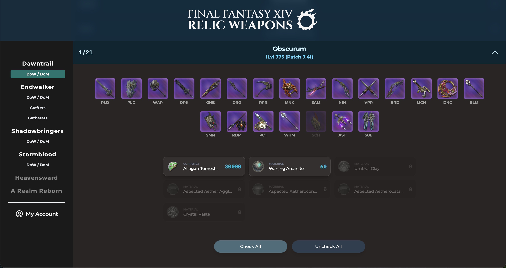

# FFXIV Relic Weapons

A checklist for Final Fantasy XIV relic weapons and tools. Tick off the ones you own and see how many materials and tomestones you still need. Sign in with Google or GitHub to save your progress; anyone can browse without an account.

**Live site:** https://finalfantasyxivrelics.netlify.app/



Built with React, Vite, Tailwind CSS and Firebase, and hosted on Netlify.

## Getting started

Requires Node 20.19+ or 22.12+.

```bash
npm ci
npm run dev
```

The app runs at http://localhost:5173. It uses the real Firebase project, so signing in locally uses real accounts. The other scripts (build, lint, format, rules tests) are in `package.json`.

## Adding a new relic step

All game data is plain JavaScript in `src/data/`:

1. **`data.js`**: add the weapons under a new category. IDs are the in-game name in `snake_case` (`phantom_sword_eclipticum`). They're saved in users' progress, so never rename an existing one.
2. **`materialsData.js`**: add the materials.
3. **`sectionData.js`**: add the section, with patch info and tomestone cost.
4. **Icons** go in `public/icons/<expansion>-icons/<category>/<id>.png`. Missing ones show a placeholder.

## Deployment

- Netlify deploys every push to `main`. CI checks formatting, lint, the build and the Firestore rules on every pull request.
- The Firestore security rules (`firestore.rules`) are **not** deployed automatically. After changing them, publish them from the Firebase console (Firestore → Rules) or with `npx firebase deploy --only firestore:rules --project ffxiv-relic-weapons`.

## Disclaimer

This is an unofficial fan project, not affiliated with or endorsed by Square Enix.

FINAL FANTASY is a registered trademark of Square Enix Holdings Co., Ltd. FINAL FANTASY XIV © SQUARE ENIX CO., LTD. All Rights Reserved.
